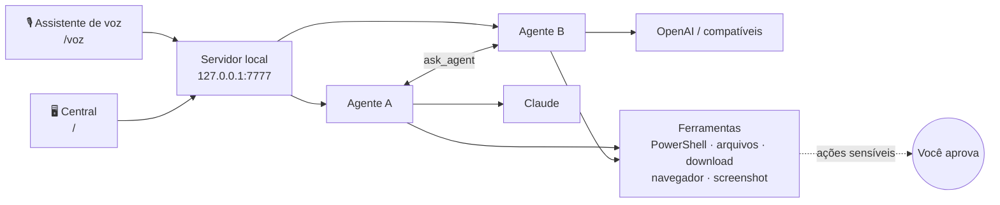

<div align="center">

# ◉ Centro de Comando

**Uma central discreta de IA para Windows: vários modelos, vários agentes conversando entre si, e um assistente de voz que executa o que você pede.**


</div>

---

## O que é

O Centro de Comando roda **na sua máquina** e coloca agentes de IA para trabalhar de verdade no Windows: programar, instalar, configurar, navegar em sites, preencher formulários, baixar arquivos e ver a tela.

Tem duas formas de usar:

| | |
|---|---|
| 🖥️ **Central de Comando** | Painel escuro e minimalista com relógio digital, temperatura atual, lista de agentes e conversa com cada um. |
| 🎙️ **Assistente "Brow"** | Janela pequena e separada. Diga *"Brow, instala o VLC"* e ele executa e responde por voz. |

## Recursos

- **Várias IAs ao mesmo tempo.** Claude (API Anthropic) e qualquer serviço compatível com OpenAI: OpenAI, Ollama, LM Studio, OpenRouter, Gemini, Groq, DeepSeek e gateways próprios.
- **Agentes que conversam entre si.** Cada agente pode delegar tarefas aos outros com `ask_agent` (até 3 níveis).
- **Controle real da máquina.** PowerShell, arquivos, downloads, navegador automatizado (Edge) e captura de tela com visão.
- **Você no comando.** Ações sensíveis param e pedem **Aprovar / Negar**, por clique ou por voz.
- **Ativação por voz.** Palavra de ativação configurável, reconhecimento e fala em português.
- **Discreto.** Os `.exe` iniciam o servidor escondido e ficam num ícone na bandeja do sistema.
- **Fácil de configurar.** Um único `config.json`, editável também pela engrenagem ⚙ na interface.

## Como funciona



## Instalação

Requisitos: **Windows 10/11**, **[Node.js](https://nodejs.org) 20+** e **Microsoft Edge** (já vem no Windows).

```powershell
git clone https://github.com/ThalesTeracin/centro-de-comando.git
cd centro-de-comando
npm install
```

Defina as chaves das IAs que for usar, como variáveis de ambiente:

```powershell
setx ANTHROPIC_API_KEY "sk-ant-..."
setx OPENAI_API_KEY "sk-..."
```

Para IA offline: `winget install Ollama.Ollama` e depois `ollama pull llama3.2`.

### Abrir

| Opção | Como |
|---|---|
| Executáveis com ícone na bandeja | Rode `launcher\build.ps1` uma vez para gerar `Centro de Comando.exe` e `Assistente.exe` |
| Atalhos `.bat` | `Iniciar.bat` (central) ou `Assistente.bat` (voz) |
| Manual | `npm start` e abra http://127.0.0.1:7777 |

## Configuração

Tudo fica em `config.json`.

```jsonc
{
  "approval": ["powershell", "write_file", "download_file", "browser_click", "browser_fill", "screenshot"],
  "wakeWords": ["brow", "brou", "brô"],
  "weather": { "city": "São Paulo", "lat": -23.55, "lon": -46.63 },
  "providers": {
    "anthropic": { "type": "anthropic", "apiKeyEnv": "ANTHROPIC_API_KEY" },
    "ollama":    { "type": "openai", "baseURL": "http://localhost:11434/v1", "apiKey": "ollama" }
  },
  "agents": [
    {
      "name": "Comandante",
      "role": "Orquestra tarefas e delega",
      "provider": "anthropic",
      "model": "claude-opus-5-5",
      "tools": ["*"],
      "system": "Você é o Comandante..."
    }
  ]
}
```

| Campo | Para que serve |
|---|---|
| `providers` | `"type": "anthropic"` ou `"openai"` (qualquer API compatível). Chave em `apiKeyEnv` (recomendado) ou `apiKey`. `maxRetries` opcional para provedores com limite de uso. |
| `agents` | Nome, papel, provedor, modelo, ferramentas (`["*"]` = todas) e instruções. `effort` e `fallbacks` opcionais para Claude. |
| `approval` | Ferramentas que pedem sua confirmação antes de rodar. |
| `wakeWords` | Palavras que ativam o assistente de voz. A primeira aparece na tela. |
| `weather` | Local da temperatura. Sem `lat`/`lon`, usa a localização do navegador. |

## Ferramentas dos agentes

| Ferramenta | O que faz |
|---|---|
| `powershell` | Executa comandos: instalar com `winget`, configurar o sistema, abrir apps, controlar teclado e mouse |
| `read_file` · `write_file` · `list_dir` | Lê, cria e lista arquivos e pastas |
| `fetch_url` | Lê o conteúdo de uma página ou API |
| `download_file` | Baixa instaladores, zips, PDFs e imagens para uma pasta |
| `screenshot` | Captura todos os monitores e envia a imagem à IA |
| `browser_open` · `browser_read` · `browser_screenshot` | Abre e lê sites num Edge controlado |
| `browser_click` · `browser_fill` | Clica e preenche formulários |
| `ask_agent` | Passa uma tarefa para outro agente |

## Assistente de voz

1. Abra `Assistente.exe` e permita o microfone.
2. Diga **"Brow, abre o bloco de notas"**, ou só **"Brow"** e espere o *"Sim?"*.
3. Quando ele pedir aprovação, responda **"sim"** ou **"não"**.

Também funciona com a tecla **Espaço**, clicando na 🎙️ ou digitando.

## Segurança

> [!WARNING]
> Os agentes **controlam a sua máquina de verdade**. Mantenha as ações perigosas na lista `approval` e leia o que está aprovando.

- O servidor escuta só em `127.0.0.1` e recusa pedidos vindos de outros sites (proteção contra CSRF e DNS rebinding).
- Prefira `apiKeyEnv` a gravar chaves no `config.json`.
- Capturas de tela e o conteúdo das conversas são enviados ao provedor de IA do agente.
- O reconhecimento de voz do Edge processa o áudio na nuvem da Microsoft. Com a ativação por voz ligada, o microfone fica aberto.

## Estrutura

```
├── server.js            servidor, agentes, ferramentas e provedores
├── config.json          IAs, agentes e preferências
├── public/
│   ├── index.html       central de comando
│   ├── app.js · style.css
│   └── voz.html · voz.js   assistente de voz
├── launcher/
│   ├── launcher.cs      código dos .exe (bandeja do sistema)
│   └── build.ps1        gera os .exe com o csc do Windows
├── selftest.js          testes (npm test)
└── Iniciar.bat · Assistente.bat
```

## Testes

```powershell
npm test
```

Verifica o bloqueio de origens externas, a validação dos parâmetros das ferramentas, a execução do PowerShell e a captura de tela.

---

<div align="center"><sub>Feito com Node.js, Edge e muitas IAs · por <a href="https://github.com/ThalesTeracin">@ThalesTeracin</a></sub></div>
